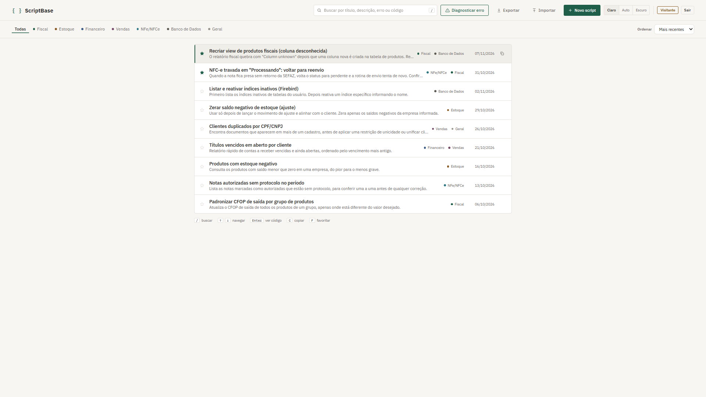
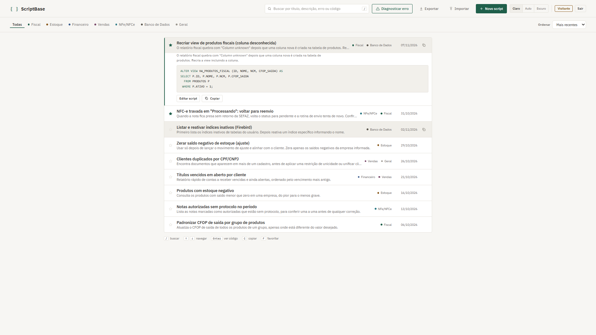
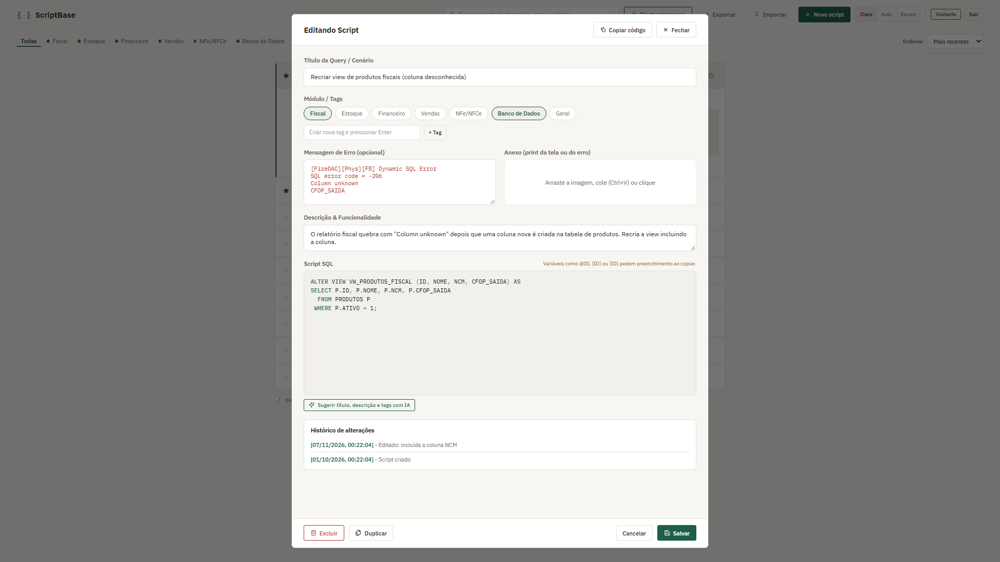
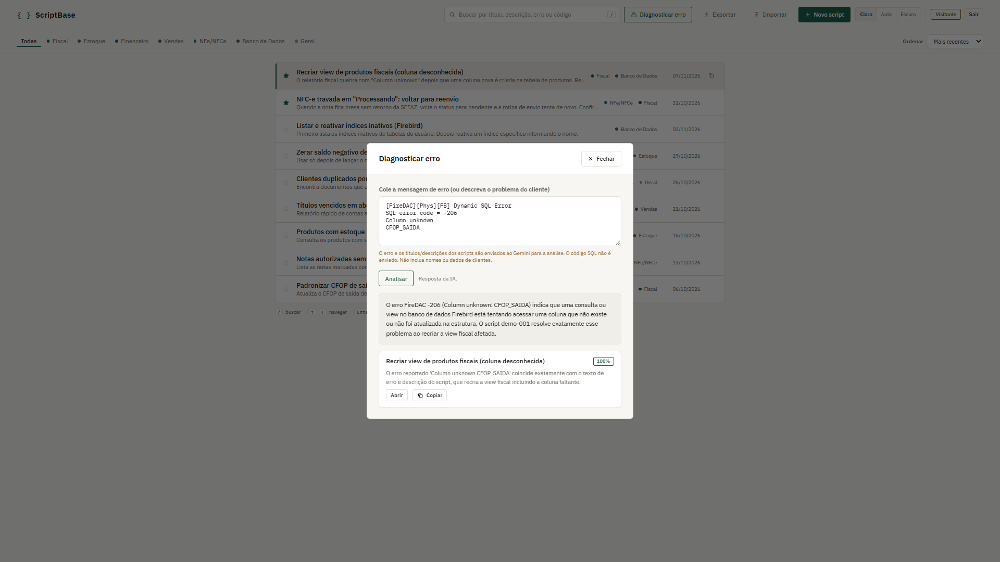

# ScriptBase

Biblioteca web para organização, busca e execução rápida de scripts SQL em rotinas de suporte técnico a sistemas ERP, com diagnóstico assistido por inteligência artificial.

Aplicação no ar: https://scriptbase-gules.vercel.app

> Acesse como visitante para testar imediatamente com dados de demonstração.

## O Problema

No suporte técnico de ERPs, o analista lida diariamente com os mesmos incidentes de banco de dados: notas fiscais travadas, inconsistências de estoque, campos nulos após atualizações e erros de integridade.

Na maioria das equipes, esses comandos ficam dispersos em blocos de notas, conversas de chat ou pastas locais. Essa desorganização gera riscos graves:

- Perda de tempo procurando consultas enquanto o cliente aguarda na linha.
- Risco de executar comandos de atualização ou exclusão sem os devidos filtros no banco de produção.
- Ausência de histórico e falta de alinhamento sobre quais scripts estão atualizados e testados.

## Por que o ScriptBase

O ScriptBase transforma esse acervo caótico em uma ferramenta de bancada rápida, segura e padronizada para a equipe:

- Segurança antes da execução: consultas com variáveis exigem preenchimento dos valores antes da cópia, e comandos destrutivos disparam alertas visuais imediatos.
- Resposta rápida em linha: busca instantânea em todo o código e navegação 100% por atalhos de teclado.
- Diagnóstico assistido: se o cliente relata um erro desconhecido, a IA analisa a mensagem e indica o script correto sem expor dados sensíveis.
- Trabalho em equipe sem fricção: a biblioteca é compartilhada por link direto com permissões completas e rastreabilidade de autoria em cada edição.

## Funcionalidades

- Busca instantânea por título, descrição, mensagem de erro ou código SQL.
- Pré-visualização rápida da query na lista com realce de sintaxe em temas claro e escuro.
- Janela para preenchimento de variáveis antes de copiar a consulta.
- Alerta visual automático para comandos destrutivos sem filtro.
- Atalhos de teclado rápidos para busca, navegação, cópia e favoritos.
- Diagnóstico de mensagens de erro via IA com motor local de contingência.
- Colaboração em equipe por link direto de convite com histórico por autor.
- Modo visitante local e modo conectado sincronizado no Supabase.

## Stack

- HTML5, CSS3 (design system Livro-razão em temas claro e escuro)
- JavaScript Vanilla (sem dependências ou etapas de build)
- Supabase (PostgreSQL, Autenticação e Row Level Security)
- Google Gemini API (função serverless na Vercel)
- Prism.js (sintaxe SQL)

## Atalhos de Teclado

- Barra: Focar no campo de busca
- Setas para cima e para baixo: Navegar pelos scripts da lista
- Enter: Expandir ou recolher o código SQL
- C: Copiar o script (abre janela se houver variáveis)
- F: Marcar como favorito
- Esc: Fechar janelas abertas

## Como Executar Localmente

Abra o arquivo index.html em qualquer navegador moderno. O modo visitante funciona imediatamente sem necessidade de instalação.

Para ativar a persistência na nuvem:
1. Configure as chaves do Supabase no arquivo config.js.
2. Execute o conteúdo de supabase/schema.sql no SQL Editor da plataforma.
3. Defina a variável GEMINI_API_KEY na Vercel para o diagnóstico por IA.
