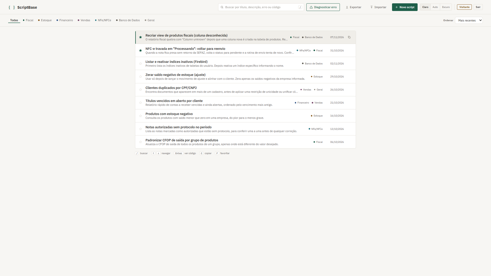
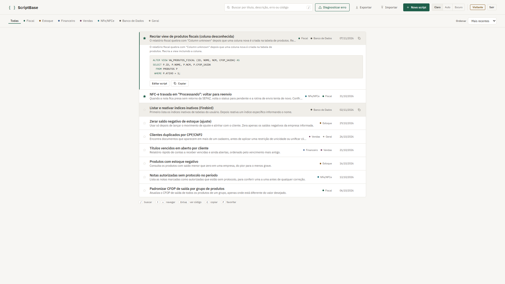
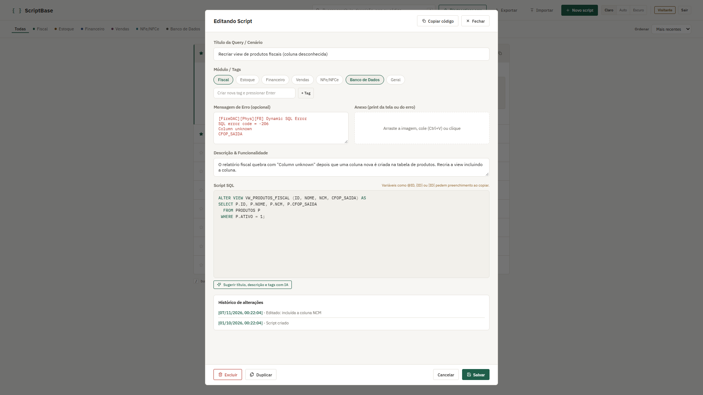
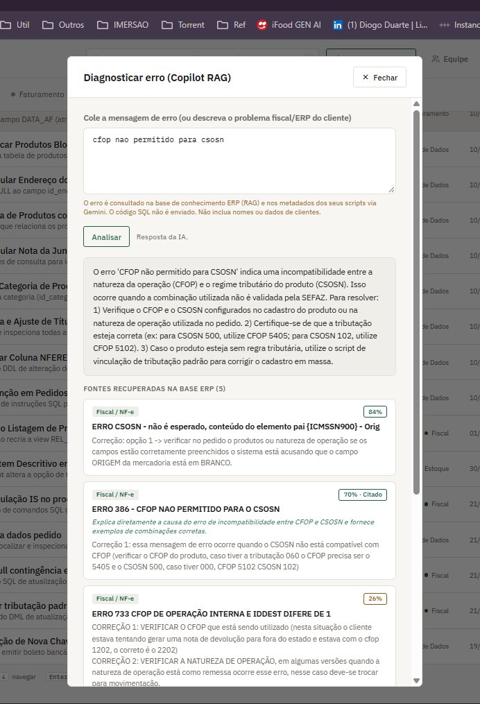

# ScriptBase

Biblioteca web colaborativa para organização, busca e preparação de scripts SQL antes de copiar em rotinas de suporte técnico a sistemas ERP, com diagnóstico de erros assistido por inteligência artificial.

Aplicação no ar: https://scriptbase-gules.vercel.app

> Acesse como visitante para testar imediatamente com dados de demonstração.

## O Problema

No suporte técnico de ERPs, o analista lida diariamente com os mesmos incidentes de banco de dados: notas fiscais travadas, inconsistências de estoque, campos nulos após atualizações e erros de integridade.

Na maioria das equipes, esses comandos ficam dispersos em blocos de notas, conversas de chat ou pastas locais. Essa desorganização gera riscos práticos:

- Perda de tempo procurando consultas enquanto o cliente aguarda atendimento.
- Risco de copiar e rodar comandos de atualização ou exclusão sem os filtros corretos no banco do cliente.
- Ausência de histórico e falta de alinhamento sobre quais scripts estão atualizados e revisados pela equipe.

## Por que o ScriptBase

O ScriptBase centraliza esse acervo em uma ferramenta de bancada simples e padronizada para o time de suporte:

- Preparação segura antes de copiar: consultas com variáveis (`@VAR`, `{VAR}`, `[VAR]`) exigem preenchimento dos valores antes da cópia, e comandos destrutivos (`DELETE` ou `UPDATE` sem `WHERE`, `DROP`, `TRUNCATE`) disparam alertas visuais imediatos.
- Resposta rápida no atendimento: busca instantânea por título, erro ou trecho SQL, com atalhos de teclado para as ações principais.
- Diagnóstico assistido: quando o cliente relata um erro desconhecido, a IA analisa a mensagem e sugere o script mais adequado da base.
- Trabalho em equipe: a biblioteca é compartilhada por link de convite, com acesso por equipe e histórico de autoria em cada edição.

## Funcionalidades

- Busca instantânea por título, descrição, mensagem de erro ou código SQL.
- Pré-visualização rápida da consulta na lista com realce de sintaxe em temas claro e escuro.
- Janela para preenchimento de variáveis antes de copiar a consulta pronta.
- Alerta visual automático para comandos destrutivos sem cláusula de filtro.
- Atalhos de teclado para busca, navegação, cópia e favoritos.
- Diagnóstico de mensagens de erro via API Gemini com busca local de contingência.
- Sugestão automática de título, descrição e tags ao cadastrar um novo script SQL.
- Colaboração em equipe por link de convite com registro de quem criou ou editou cada script.
- Modo visitante local (dados de exemplo no navegador) e modo conectado sincronizado no Supabase.

## Como a IA Funciona

A integração com a API do Google Gemini (via função serverless em `api/ai.js`) atua em duas frentes independentes:

- **Diagnóstico de erros (`AI.diagnose`):** recebe a mensagem de erro informada pelo analista e a lista de títulos, descrições, tags e erros conhecidos da equipe para indicar qual script resolve o caso e explicar o motivo em linguagem direta, sem enviar o código SQL completo das consultas.
- **Sugestão de metadados (`AI.suggest`):** ao cadastrar ou documentar um script, analisa até 2.000 caracteres do comando SQL para sugerir título, descrição resumida e tags padronizadas.
- **Contingência local (`ai.js`):** se a chave de API não estiver configurada ou o serviço externo falhar, o sistema recorre automaticamente a um motor local que pontua os scripts por palavras-chave e expressões regulares.

## Limites Atuais

- A aplicação não conecta nem executa comandos diretamente no banco de dados do ERP; ela prepara, valida variáveis e copia a consulta para o analista executar no gerenciador do banco.
- A busca e o diagnóstico operam sobre os metadados e textos cadastrados (ainda sem busca vetorial/RAG com embeddings).
- O endpoint `/api/ai` utiliza cadeia de fallback entre modelos rápidos do Gemini, mas ainda não possui controle próprio de *rate limit* por usuário.

## Stack

- HTML5, CSS3 e JavaScript (sem etapa de build)
- Supabase (banco de dados em nuvem, autenticação e políticas de acesso RLS)
- Google Gemini API (função serverless na Vercel)
- Prism.js (realce de sintaxe SQL)

## Atalhos de Teclado

- Barra (`/`): Focar no campo de busca
- Setas para cima e para baixo: Navegar pelos scripts da lista
- Enter: Expandir ou recolher o código SQL
- C: Copiar o script (abre janela se houver variáveis)
- F: Marcar como favorito
- Esc: Fechar janelas abertas

## Como Executar Localmente

Abra o arquivo `index.html` em qualquer navegador moderno. O modo visitante funciona imediatamente sem necessidade de instalação.

Para ativar a persistência na nuvem e a IA:
1. Configure a URL e a chave pública do projeto Supabase no arquivo `config.js`.
2. Execute o conteúdo de `supabase/schema.sql` no SQL Editor do Supabase.
3. Na Vercel (ou ambiente serverless equivalente), defina a variável de ambiente `GEMINI_API_KEY` para habilitar as chamadas em `api/ai.js`.
