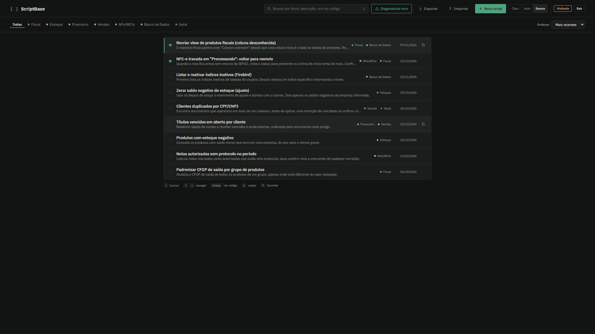

# ScriptBase

Biblioteca web para organização, busca e execução segura de scripts SQL em rotinas de suporte técnico a sistemas ERP, com diagnóstico assistido por inteligência artificial.

Link da aplicação: https://scriptbase-gules.vercel.app

> Para testar a ferramenta no ar, basta entrar como visitante. Os registros exibidos na demonstração são scripts fictícios para proteção de dados.

## O problema real

Trabalhando no suporte técnico de ERPs e sistemas de gestão, a rotina de atendimento frequentemente lida com os mesmos incidentes de banco de dados várias vezes ao dia. São notas fiscais presas em processamento, inconsistências em tabelas de estoque após quedas de energia, campos nulos após atualizações de versão e erros conhecidos de integridade referencial.

Na prática, a maioria das equipes mantém esses comandos salvos em blocos de notas soltos, conversas de chat ou pastas locais no computador. Esse hábito traz riscos sérios para a operação. Fica difícil encontrar o script exato enquanto o cliente aguarda na linha, o risco de rodar comandos de atualização ou exclusão sem os filtros corretos é alto, e não existe histórico de quando aquele comando foi usado ou alterado pela última vez.

O ScriptBase foi criado para centralizar essas soluções em uma interface rápida, limpa e com travas de segurança.

## O que a ferramenta faz

A busca funciona de forma instantânea por título, descrição, trechos da mensagem de erro e até pelo texto dentro do próprio código SQL. 

Para agilizar o atendimento, a ferramenta conta com atalhos de teclado simples. Você pode pressionar a barra para buscar, usar as setas para navegar entre as linhas, Enter para abrir o código, C para copiar e F para favoritar. 

Ao clicar em qualquer linha da lista, o código SQL é exibido logo abaixo com realce de sintaxe suave, permitindo conferir a consulta sem sair da tela principal. 

Comandos que contêm variáveis abrem uma janela de preenchimento antes da cópia, garantindo que o analista informe os valores reais antes de executar o script no cliente. Queries com comandos destrutivos recebem um alerta visual de atenção, e cada script guarda seu próprio histórico com anotações de alterações e data da última modificação.

## Colaboração em equipe

Para equipes que trabalham lado a lado no atendimento, o ScriptBase permite compartilhar a biblioteca por link direto de convite, sem atrito de configuração.

O proprietário da base gera um link exclusivo no botão Equipe e envia para os colegas de trabalho. Ao abrir o link, o colega entra na conta dele ou cria o cadastro na hora, sendo vinculado automaticamente ao espaço compartilhado.

Com isso, todos os membros da equipe podem consultar, criar e editar scripts juntos. Cada alteração realizada registra automaticamente a data e o e-mail do autor no histórico de revisões do script, garantindo rastreabilidade sobre quem fez cada modificação. Pelo painel de gerenciamento, o proprietário visualiza quem já entrou e pode revogar acessos ou gerar um novo link de convite quando quiser.

## Uso de Inteligência Artificial

A ferramenta utiliza inteligência artificial para acelerar a resolução de chamados sem colocar em risco dados sensíveis.

No diagnóstico de erro, o analista cola a mensagem retornada pelo banco ou pela aplicação, como erros comuns de Firebird e FireDAC. A IA analisa os scripts cadastrados na base e aponta a solução mais adequada, acompanhada de uma explicação técnica objetiva e do percentual de compatibilidade com o problema.

Ao cadastrar um novo script, o sistema também sugere título, descrição e categorias pertinentes com base na estrutura da consulta enviada.

O código SQL do cliente e informações de bancos locais nunca são enviados para a análise de diagnóstico. Apenas a mensagem de erro e os resumos dos scripts cadastrados passam pela IA. Além disso, caso a conexão com a API falhe ou fique indisponível, o sistema ativa automaticamente um motor local de busca por termos no próprio navegador, mantendo o trabalho do suporte sem interrupções.

## Design e Temas

A interface utiliza o tema Livro-razão, pensado para rotinas de trabalho prolongadas. O visual prioriza clareza e contraste, utiliza a tipografia técnica IBM Plex e oferece suporte nativo aos modos Claro, Escuro e Automático, respeitando a preferência do sistema operacional.

## Arquitetura

O projeto foi construído de forma enxuta e sem processos pesados de compilação, o que facilita a leitura e a manutenção do código.

O navegador roda HTML, CSS e JavaScript puro. No modo visitante, os dados ficam salvos exclusivamente no armazenamento local da máquina. Na conta conectada, as informações sincronizam com o Supabase, utilizando PostgreSQL protegido por regras de segurança por linha (RLS), permitindo a colaboração entre proprietários e membros autorizados da equipe com isolamento total dos dados. As consultas de inteligência artificial passam por uma função no servidor da Vercel para comunicar com o Google Gemini sem expor chaves públicas no navegador.

## Como executar localmente

Para rodar o projeto no seu computador, basta clonar o repositório e abrir o arquivo index.html em qualquer navegador moderno. O modo visitante funciona imediatamente, sem exigir nenhuma configuração externa.

Para habilitar a persistência na nuvem e os recursos de IA, configure o arquivo de configuração com as chaves públicas do seu projeto no Supabase, execute o script do banco no editor SQL da plataforma e adicione a chave da API do Gemini nas variáveis de ambiente da sua hospedagem.

## Sobre o desenvolvimento

Projeto desenvolvido para resolver uma dor real do dia a dia de suporte técnico a sistemas ERP, unindo segurança de dados, usabilidade limpa e inteligência artificial aplicada à produtividade da equipe.
